

# Resetta

**A calm, illustrated burnout self-tracker for working people: twelve baseline questions, three daily ones, a smoothed score that settles into one of four named states, and a Recovery Mode built around whatever is driving it.**

**Android · iOS** 
Flutter · Dart · Riverpod · go_router · Hive · Firebase

<table>
  <tr>
    <td align="center">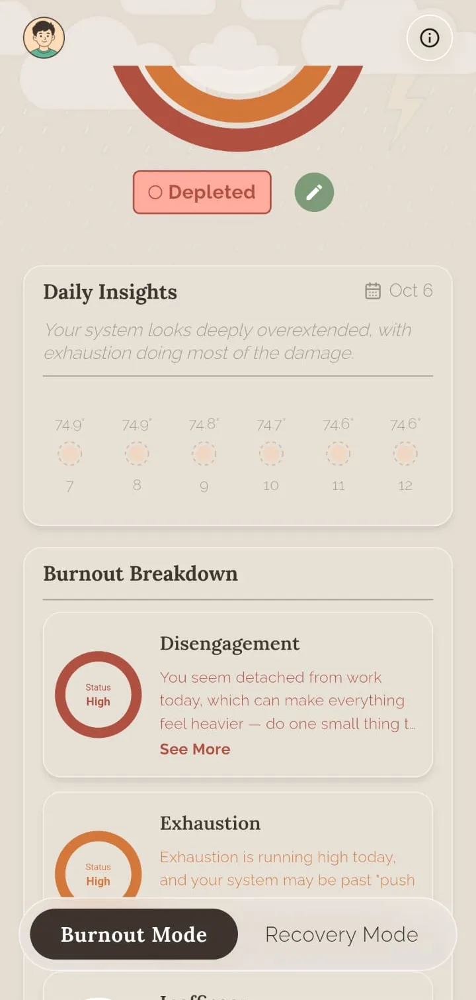</td>
    <td align="center">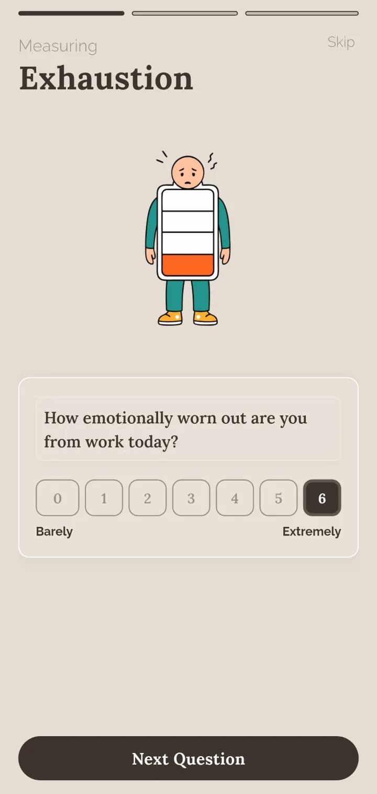</td>
    <td align="center">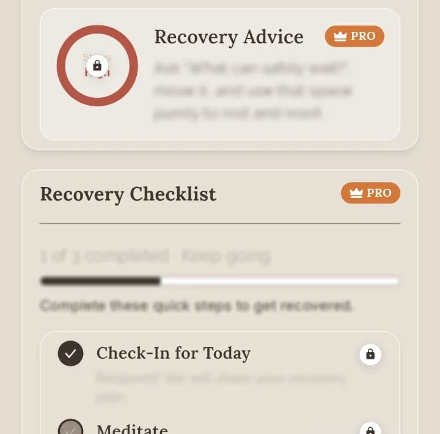</td>
  </tr>
</table>
Real screenshots from the Android build, cropped to the app content (system status bar and ad-placeholder strips removed), captured with sample/placeholder data.

---

## Get the App

  
  

Resetta is a self-reflection and tracking tool. It does not diagnose, treat or replace professional advice, and the app itself carries a not-medical-advice disclaimer.

## The Idea in One Picture

Resetta is built like a small state machine that people can read at a glance. Answers go in one end, get smoothed so a single rough day does not whip the result around, and come out as one of four named states. The state decides what the home screen looks like and which recovery content leads. The state names are the app's own labels for positions on its own scale; they are not descriptions of a condition or a clinical category.

  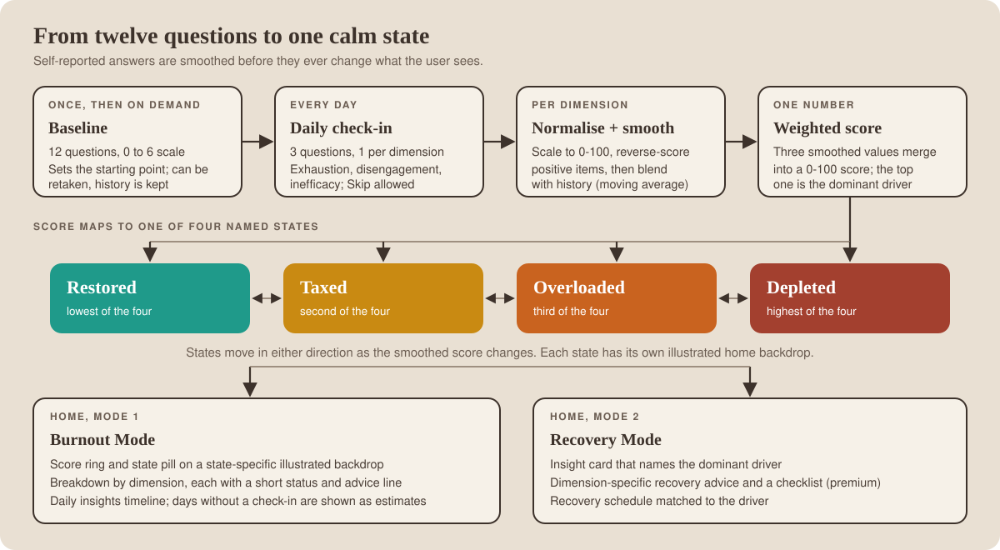

## Product at a Glance

| | |
|---|---|
| **What it is** | A burnout self-tracker: a 12-question baseline, then three short daily questions, one each for exhaustion, disengagement and inefficacy |
| **Output** | A 0-100 score, one of four states (Restored, Taxed, Overloaded, Depleted) and the dominant driver |
| **Two home modes** | Burnout Mode (score, breakdown, daily insights) and Recovery Mode (insights, dimension-specific advice, checklist, schedule) |
| **Honest estimates** | Days without a check-in are shown as estimates, never as measurements; past projections are frozen |
| **Reminders** | A daily reminder at a user-chosen time, plus on-device engagement logic |
| **Business model** | Freemium: ads on the free tier, a premium subscription that unlocks recovery advice, checklist, journal notes, weekly insights, longer history and a monthly PDF export |
| **Services** | Firebase (Auth, Firestore, Messaging, Analytics, Crashlytics, Performance, Remote Config), a product-analytics SDK, store billing, an ad-mediation SDK |
| **Code size** | About 240 hand-written Dart files and 65k lines of app code (generated files excluded), plus 12 unit-test files of about 2.4k lines |

## Walkthrough

### 1. Getting set up

<table>
  <tr>
    <td align="center">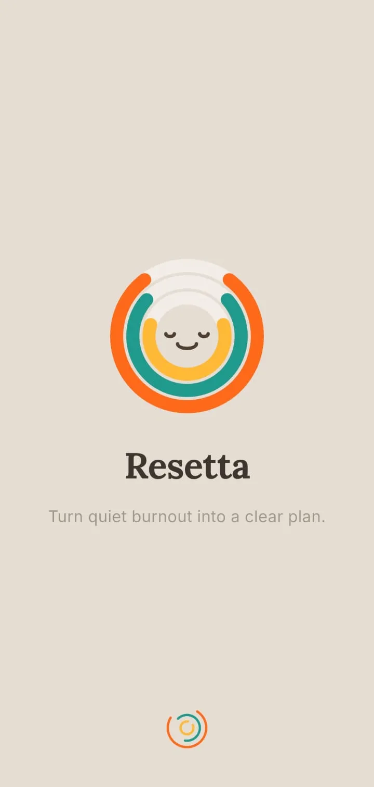 <b>Splash</b> Rings logo and tagline on a warm paper background</td>
    <td align="center">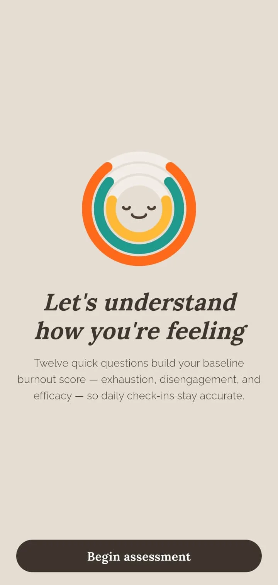 <b>Baseline intro</b> Twelve questions across three dimensions</td>
    <td align="center">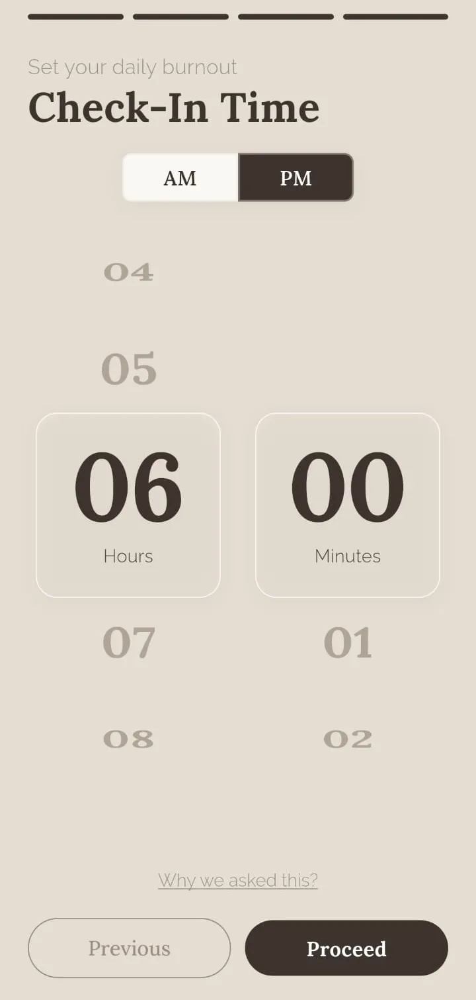 <b>Check-in time picker</b> The daily reminder time is chosen during setup</td>
  </tr>
</table>

### 2. The daily loop

<table>
  <tr>
    <td align="center"> <b>Daily check-in question</b> One illustrated question per dimension, 0 to 6, with Skip</td>
    <td align="center">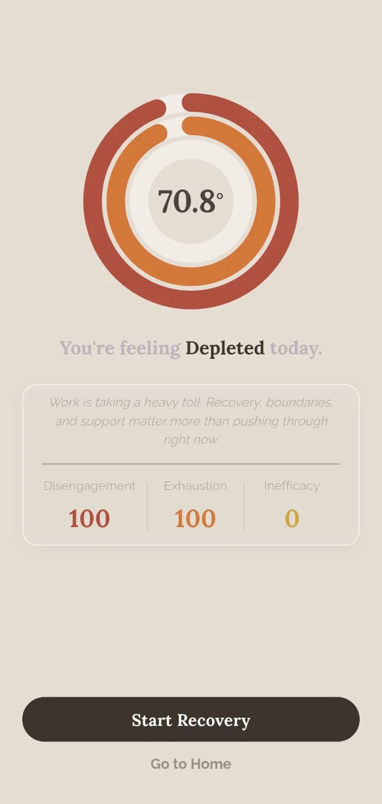 <b>Score result screen (sample session)</b> State name, a short message and the three dimension values</td>
  </tr>
</table>

### 3. Dashboard, Recovery Mode and settings

<table>
  <tr>
    <td align="center"> <b>Home, Burnout Mode</b> State pill on a weather-themed backdrop, daily insights, dashed placeholders for upcoming days</td>
    <td align="center">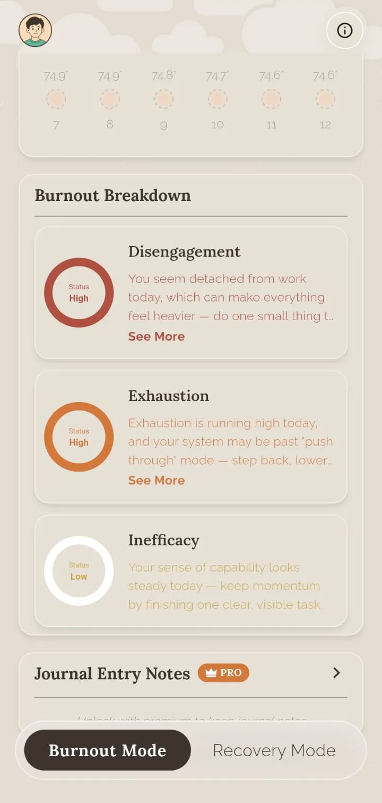 <b>Burnout breakdown</b> A status ring and short advice line per dimension; journal notes are a premium feature</td>
    <td align="center"> <b>Recovery Mode: locked advice and checklist (premium)</b> Recovery advice and checklist preview, locked behind premium</td>
  </tr>
  <tr>
    <td align="center">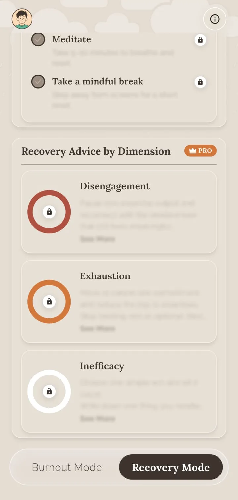 <b>Locked recovery advice</b> Per-dimension advice behind the premium gate, blurred with a lock</td>
    <td align="center">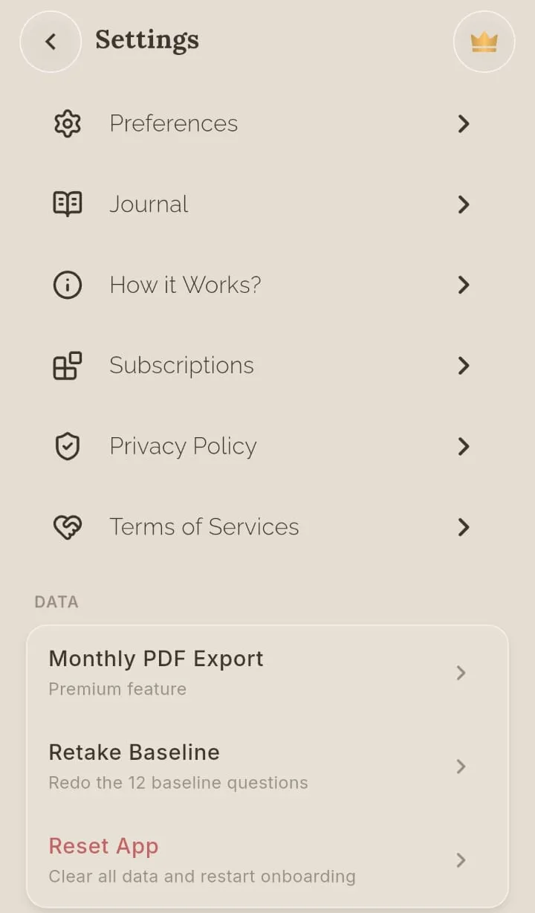 <b>Settings</b> Monthly PDF export, retake baseline, reset app</td>
    <td></td>
  </tr>
</table>

## Free and Premium

| Area | Free | Premium (gated in the app) |
|---|---|---|
| Baseline, daily check-in, score, state, dominant driver | Included | Included |
| Burnout breakdown per dimension | Included | Included |
| Recovery insight summary | Included | Included |
| Recovery advice by dimension and recovery checklist | Locked preview | Unlocked |
| Journal notes | Teaser | Unlocked |
| Weekly insights, longer history, multi-day recovery schedule | Limited or locked | Unlocked |
| Monthly PDF export | Locked | Unlocked |
| Ads | Shown | Suppressed |

Paywall layouts and placements can be switched through remote configuration.

## Design Choices Worth Reading About

- **A state machine people can feel.** Four states, each with its own illustrated home backdrop, so a glance tells the user where they stand before they read a number.
- **Recovery Mode is not a second dashboard.** It re-centres the same data on the dominant driver: which dimension is highest decides the advice, the checklist and the schedule that lead.
- **Estimates are labelled as estimates.** A date with no check-in is held, interpolated or projected, and the UI says so. Past projections are frozen so a later retake does not rewrite history.
- **Skipping is a first-class action.** Missing days are never penalised; the question screen has a Skip control and backfilling past days recomputes the smoothing chain forward.
- **Illustrated, tactile questions.** Each dimension has its own character illustration, and the wording of each question rotates so the daily ritual does not read like a form.

## Engineering Highlights

### Smoothing a noisy self-report
- **Problem:** a 0 to 6 self-rating swings with mood. One bad day should not flip someone to the top state, and one good day should not erase a pattern.
- **Approach:** normalise answers to 0-100, reverse-score the positively worded items, smooth each dimension with an exponential moving average seeded from the baseline, then combine the three smoothed values with weights into the score. The smoothing strength depends on the user's work profile and is damped while history is short. Exact weights and constants are not published.
- **Outcome:** a deterministic, explainable pipeline in plain Dart with documented edge cases (for example, a first good day after a poor baseline does not snap to the lowest state), covered by unit tests.

### Never showing an estimate as a measurement
- **Problem:** people skip days, but the timeline still has to show something for every date without implying data that does not exist.
- **Approach:** a resolver assigns every calendar date a kind (checked in, interpolated between real check-ins, held, early estimate, projection, baseline estimate or no data) and a user-visible label. Past projections are frozen.
- **Outcome:** a skip-friendly timeline whose estimates are visibly estimates. This logic has the largest test file in the project.

### Local-first, with careful sync
- **Problem:** the app has to work without an account and offline, then reconcile across devices when a user signs in.
- **Approach:** Hive is the only thing the UI reads. For signed-in users, Firestore is the cloud source of truth: an initial sync decides whether to push or pull, writes are batched, a timestamp rule stops a stale device overwriting a newer edit, and a generation counter invalidates in-flight syncs on sign-out.
- **Outcome:** the daily loop works fully offline by design, and pending edits flush when connectivity returns. Sync is not covered by automated tests.

### A notification engine with no server component
- **Problem:** reminders must fire with the app closed, survive reboots and time zones, and also serve activation and conversion goals.
- **Approach:** OS-scheduled daily reminders (exact alarms with an inexact fallback), a campaign selector driven by local check-in state, a sticky split test on reminder copy, push messages re-shown locally so taps keep their deep links, and an internal deep-link payload format.
- **Outcome:** engagement logic evaluated on the device, with no cloud functions involved.

### Ads and billing that cannot hang launch
- **Problem:** ad SDK start-up, consent prompts and ad loads vary wildly in latency, and ad networks rate-limit bursts of requests.
- **Approach:** a start-up gate with per-platform timeouts, retry caps and a hard ceiling; a per-zone request throttle that every caller goes through; a preload coordinator that keeps one ad warm per format; remote switches per placement; premium users skip ads entirely.
- **Outcome:** bounded launch time and coordinated requests. No revenue or fill-rate claims are made.

More detail, trade-offs and what is not covered: [docs/ENGINEERING_CHALLENGES.md](docs/ENGINEERING_CHALLENGES.md).

## Architecture

  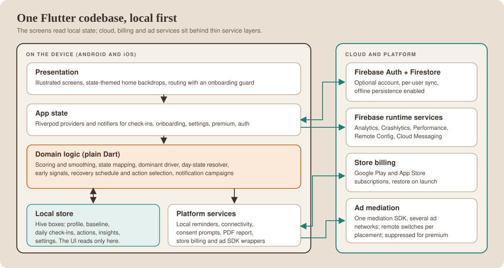

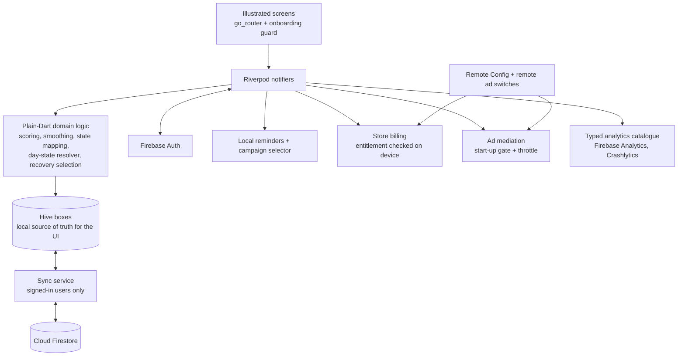

The user lifecycle, as a state diagram:

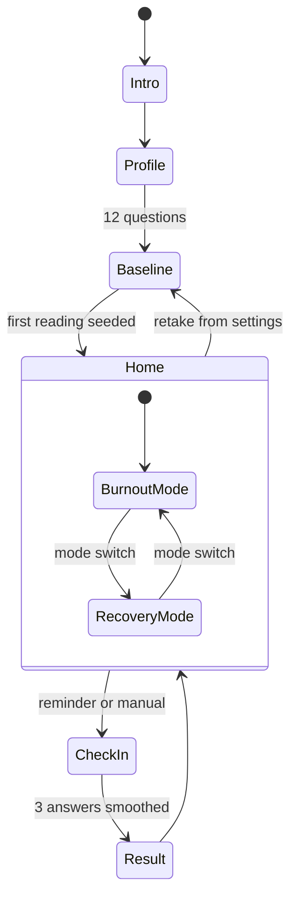

More diagrams, including the check-in data flow, sync and start-up: [docs/ARCHITECTURE.md](docs/ARCHITECTURE.md).

## Technology Stack

| Layer | Technology |
|---|---|
| App framework | Flutter / Dart |
| State management | Riverpod (`flutter_riverpod`) with notifiers and providers |
| Navigation | `go_router` with a redirect guard driven by onboarding state |
| Models | Generated immutable models with JSON serialisation |
| Local persistence | Hive boxes holding JSON maps, keyed by date for check-ins |
| Cloud | Firebase Auth, Cloud Firestore (offline persistence enabled), Cloud Messaging, Remote Config |
| Sign-in | Email and password, Google, Apple (implemented in the codebase) |
| Notifications | Local scheduled notifications with time-zone support, Firebase Cloud Messaging |
| Billing | Store subscriptions through the platform billing libraries |
| Ads | One ad-mediation SDK with several adapter networks, via a locally forked Flutter plugin |
| Observability | Firebase Analytics, Crashlytics, Performance, a product-analytics SDK; a typed event catalogue |
| Reports | On-device PDF generation and share sheet for the monthly report |
| UI | Custom theme, bundled serif and sans fonts, character illustrations, SVG assets, animation helpers |
| Tests | `flutter_test` unit tests for scoring, smoothing, day-state resolution, notifications and the analytics catalogue |

## Honest Trade-offs

- **Entitlement is verified on the device.** Server-side receipt verification is a planned hardening step.
- **Local data relies on the platform app sandbox.** Optional at-rest encryption for journal text would be a sensible hardening step.
- **Projected days are simple.** Projected days use a straightforward trend with bias correction, not a trained model.
- **Sign-in entry point.** Account sign-in and cloud sync are implemented, but the entry point is controlled by a build-time switch. This portfolio does not claim it is active in any particular store build.
- **Test coverage is partial.** Scoring, smoothing, day-state resolution, notification copy and analytics rules have tests; sync, auth, billing and ads do not.
- **English-only copy** today.

## Wellness Positioning

Resetta is a self-reflection tool. The scores are the app's own summary of what the user typed in; they are not a medical measurement and are not a diagnosis. The app tells users it provides wellness insights, is not medical advice, and that they should consult a healthcare professional for medical concerns. Nothing in this repository makes claims about health outcomes.

## Documentation

| Read | For |
|---|---|
| [Product overview](docs/PRODUCT_OVERVIEW.md) | The user journey, the four states, Recovery Mode, free versus premium |
| [Technical case study](docs/TECHNICAL_CASE_STUDY.md) | End-to-end technical write-up |
| [Architecture](docs/ARCHITECTURE.md) | Diagrams and component responsibilities |
| [Engineering challenges](docs/ENGINEERING_CHALLENGES.md) | Problem, approach, trade-offs, outcome |
| [Privacy and source](docs/PRIVACY_AND_SOURCE.md) | What is and is not published |
| [Rights](RIGHTS.md) | Usage terms |

## Source Code

This repository is a portfolio showcase for a production application. Production source code is maintained privately. See [RIGHTS.md](RIGHTS.md) for usage terms.
