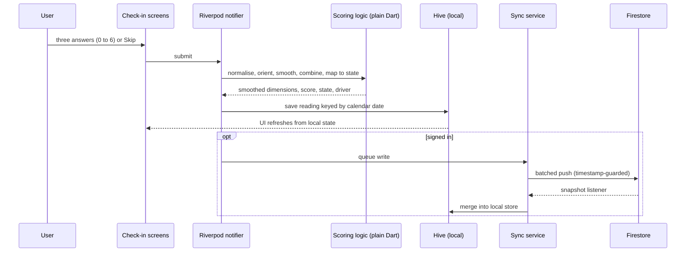
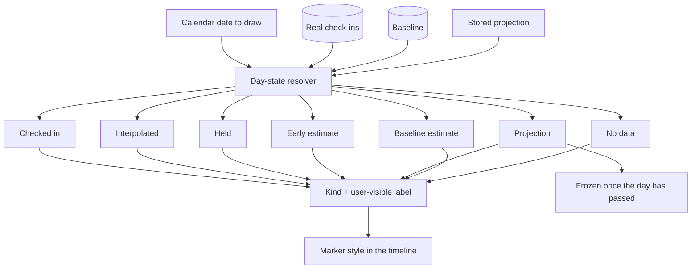
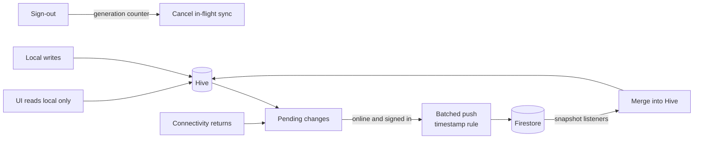
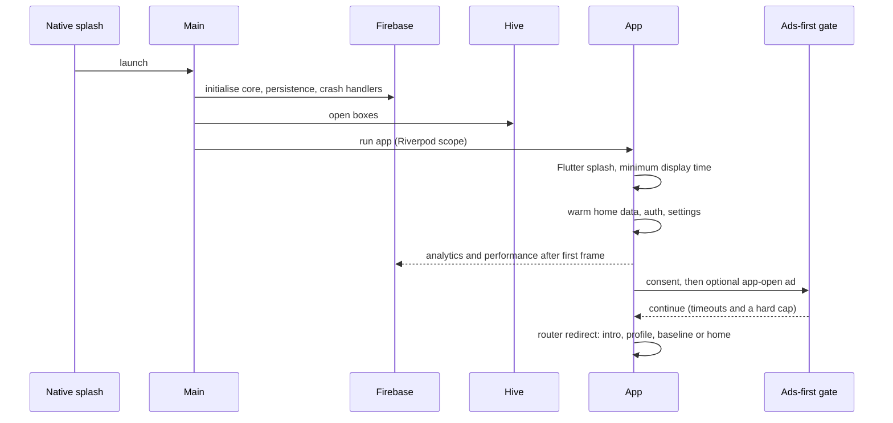
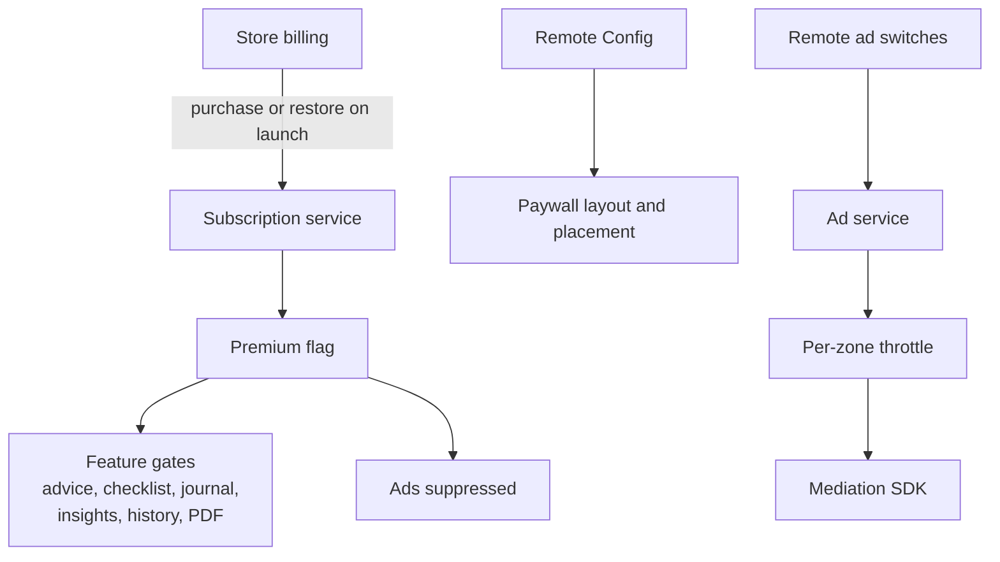

# Architecture

All diagrams are original and conceptual. Component names describe responsibilities; they are not the names of production classes, files or collections.

## 1. System overview

  

The app is layered so that the parts that carry the product's meaning (scoring, state mapping, day resolution, recovery selection) are plain Dart with no framework imports. Everything that touches an SDK sits behind a service.

| Layer | Responsibility |
|---|---|
| Presentation | Screens and widgets: onboarding, check-in, results, home with two modes, settings, paywall, journal. Illustrated, state-themed visuals. |
| Routing | A single router with a redirect guard. Onboarding flags decide whether the user is sent to intro, profile, baseline or home. Overlay routes cover check-in, results, paywall and settings. |
| App state | Riverpod notifiers and providers for check-ins, onboarding, settings, premium status, authentication, journal and insights. A sync-tick provider refreshes the UI after cloud merges. |
| Domain logic | Scoring, smoothing, state mapping, dominant driver, day-state resolution, early signals, schedule and action selection, notification campaign selection. Pure and unit-testable. |
| Local store | Hive boxes of JSON maps. The only data source the UI reads. |
| Services | Sync, notifications, subscriptions, ads, consent, connectivity, analytics, PDF generation, remote configuration. |
| Native glue | A small amount of Kotlin and Swift: splash handling, App Tracking Transparency, push registration. |

## 2. The check-in data flow

The central loop is a write-local-first pipeline. The UI never waits for the network.

Backfilling a past day follows the same path, then recomputes the smoothing chain forward from that date and refreshes the dependent projections.

## 3. Score to state to modes

  

The state is a pure function of the smoothed score, so the same value always produces the same name. The two home modes are views over the same data: Burnout Mode renders the score, ring and breakdown; Recovery Mode re-orders content around the dominant driver and applies the premium gates.

## 4. Day-state resolution

Every date the UI draws goes through one resolver rather than ad hoc logic in widgets.

The resolver output carries a label so estimates are visibly estimates. Past projections are frozen, which is why a retake or backfill cannot silently change what the user already saw.

## 5. Local-first sync

Rules that keep it safe:

- **One read path.** Widgets read Hive; the network only ever changes Hive through the merge step.
- **Timestamp guard.** A push is skipped only when the cloud copy is strictly newer; local wins ties and un-stamped cloud records.
- **Generation counter.** Each sign-in starts a generation. A sync from an earlier generation cannot write after sign-out.
- **Shared initialisation.** The first sync is a single shared future so concurrent callers do not duplicate work.
- **Account health.** On start-up, resume or a permission-style failure, a token refresh confirms the account still exists; otherwise the user is signed out locally with an explanatory dialog.

## 6. Start-up sequence

Analytics and performance collection start after the first frame, and on iOS analytics stays off until the tracking prompt has been presented.

## 7. Notifications

Reminders are OS-scheduled local notifications at the user's time, with an exact-alarm attempt and an inexact fallback. A boot receiver reschedules on Android. A campaign selector picks engagement, lifecycle or conversion messages from local state. Push arrives through Cloud Messaging and is re-shown locally in the foreground so taps keep their destination. Taps are routed through an internal deep-link format that is only used for notification payloads.

## 8. Monetisation components

Entitlement checks are client-side; server-side receipt verification is a natural next step.

## 9. Data stored (conceptual)

| Data | Where |
|---|---|
| Profile and onboarding progress | Local; synced for signed-in users |
| Baseline answers and results | Local; synced |
| Daily readings (raw answers, smoothed values, score, flags, projection outputs) | Local, keyed by date; synced |
| Completed recovery actions | Local; synced |
| Journal notes and weekly reflections | Local; synced |
| Settings (reminder time and enabled flag) | Local; synced |
| Premium state | Derived from store state at launch |
| Trial tracker | Local |

Local boxes depend on the platform's app sandbox. The cloud holds per-user documents that the project's rules limit to their owner.

## 10. Platform notes

- Android and iOS from one codebase; phones in portrait. No web or desktop targets.
- Release builds on Android use code and resource shrinking.
- The ad plugin is a local fork; its changes are contained in the plugin, not in app code.
